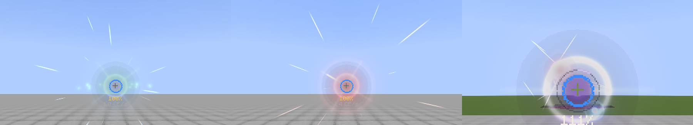
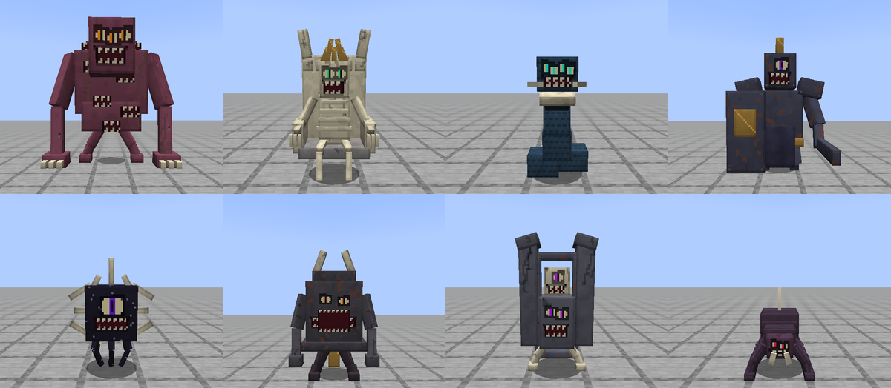
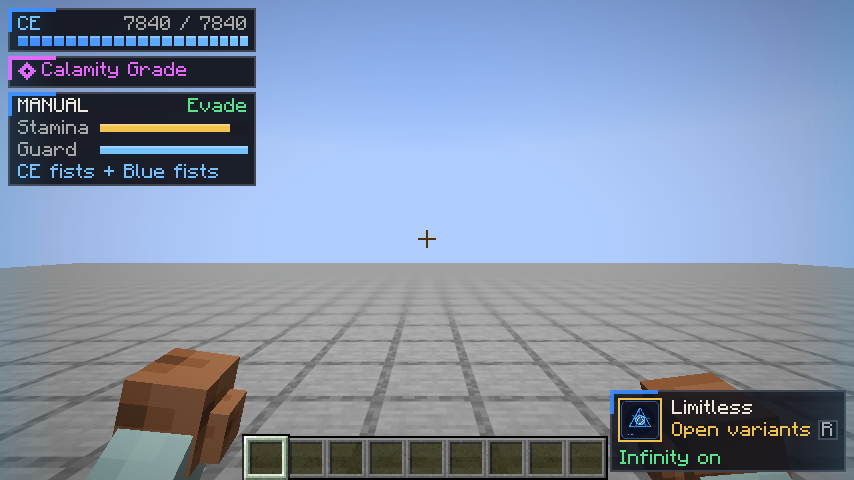

# Jujutsu Craft (`jjkcraft`)

A Fabric mod for Minecraft Java 26.3 inspired by Jujutsu Kaisen. Awaken as a sorcerer, grow
your cursed energy, master an innate technique, fight original curses and expand your own
domain.

**Status: 1.18.0-preview.** Feature-complete for single player and tested with automated
server and client scenarios; balance still needs human playtesting. See
[Known issues](#known-issues).

## What's in it

- **Cursed energy and grades.** Every sorcerer has a CE pool that regenerates and can be
  overexerted. Climb from Grade 4 to Special Grade and Calamity through grade experience,
  measured stats and trials, with a promotion ceremony at each step.
- **296 techniques in 51 families.** Limitless (Blue, Red, Hollow Purple, Infinity), Shrine
  (Cleave, Dismantle), Blood Manipulation, Cursed Speech, Ten Shadows with all ten
  shikigami, Projection Sorcery, Idle Transfiguration and many more, plus twenty original
  families. Suitable moves charge while held; Hollow Purple charges to 200%.
- **Mastery and personalization.** Moves grow stronger with landed use. A per-move workshop
  tunes output (up to an earned 3,000%), reach, area, duration, colour and trails, and ten
  optional binding vows trade restrictions for power.
- **Cursed Combat.** Separate left and right punches, heavies, guards and parries, dashes,
  stamina and an optional Auto Combat assist. Black Flash, Reverse Cursed Technique and
  CE-coated fists build on the same contact system.
- **Domain Expansion.** Nine domains with sure-hit effects, interior scenery, clashes,
  burnout, Simple Domain and a workshop for radius, output, duration and barrier strength.
- **52 original curses.** Grade 4 to Special Grade, each with a telegraphed mechanic and a
  counter, spawned by a fear field that rises with darkness and death.
- **Training.** Straw dolls, breathing mats, focus stones and balance beams develop
  strength, endurance, agility, weapon skill, reinforcement and reverse flow.
- **The Culling Game.** Colonies, points, negotiable rules and NPC entrants for solo play.
- **Equipment.** Cursed tools that lend techniques, four armor sets and Sukuna's Finger.

Canon names follow the Jujutsu Kaisen Wiki ([naming notes](docs/NAMING.md)). All art, models
and sounds are original and generated by the scripts in `tools/`; the mod contains no
official Jujutsu Kaisen assets.

## Installing

1. Install [Fabric Loader](https://fabricmc.net/use/) 0.19.5 or newer for Minecraft 26.3.
2. Put these jars in your `mods/` folder:
   - `jjkcraft-1.18.0-preview.jar`
   - Fabric API 0.163.0+26.3 or newer
   - GeckoLib 5.5.7 or newer
   - Cloth Config 26.3.159 or newer
   - Mod Menu (optional, adds a config button)
3. For multiplayer, install the mod on both the server and every client.

## First steps

1. On your first join the **Awakening** screen asks how to receive your innate technique:
   inherit a clan technique or roll a random one. In Creative you can pick any family.
2. Press **J** to open your profile. **Moves** shows what you know; bind moves or whole
   families to your twelve slots.
3. Hold **G** and scroll to pick a slot, then press or hold **R** to cast. Families open a
   wheel of their learned moves.
4. Press **Y** to enter Cursed Combat and fight with your fists. A short reminder of the
   combat keys appears the first time you switch it on in each world.
5. Craft training props (straw doll, mat, focus stone, balance beam) to learn reinforcement
   and Reverse Cursed Technique and to improve your body.

## Controls

Every key can be changed in **Options → Controls → Jujutsu Craft**.

| Action | Default |
|---|---|
| Cast the selected technique (hold to charge suitable moves) | R |
| Technique wheel: hold, scroll, release to select | G |
| Next slot / next bank of four | V / Backslash |
| Cast slots 1–4 of the current bank | Numpad 1–4 |
| Sorcerer profile | J |
| Toggle Cursed Combat | Y |
| Right punch / left punch (double-tap for an uppercut) | U / I |
| Heavy hit (double-tap for a sweep) | ; |
| Block / parry (crouch to guard low) | ] |
| Dash or evade (escapes a stagger for 33 CE) | Left Alt |
| Lock on | Z |
| Toggle Auto Combat / CE-coated fists | F7 / O |
| Domain Expansion / Simple Domain | K / N |
| Toggle Reverse Technique healing | H |
| Sense curses | B |
| Culling Game map | M |
| Visual design studio | F6 |

With combat on and Auto Combat enabled (the default), holding attack chooses simple
attacks and guards for you; manual keys always take priority. Q, E, F and the hotbar keys
keep their vanilla behaviour.

## The HUD

The status column in the top-left shows CE, your grade and, while combat is on, stamina,
guard and evade readiness. Event panels (Culling Game, subjugation rituals, resonance)
stack beneath it. Your selected power sits beside the hotbar with its cost or cooldown,
and a ring around the crosshair fills while you charge. Every element can be moved,
resized, hidden or faded in the client config or the F6 design studio.

## Configuration

- `config/jjkcraft-server.json5`: system toggles, CE numbers, death policy, Black Flash and
  RCT chances, domain numbers, curse spawn rates and caps, the Culling Game and Modulo.
- `config/jjkcraft-client.json5`: HUD layout, VFX levels, camera shake, hit-stop, reduced
  motion, reduced flashing, a colourblind palette, UI scale and the sound mix.

## Commands

All under `/jjk` for operators (permission level 2): `energy`, `config reload`, `grade`,
`xp`, `awaken`, `counter`, `progress reset`, `technique`, `curse`, `fear`, `sense`, `domain`,
`blackflash force`, `reverse`, `vow`, `culling` and `modulo`. Each command lists its
sub-commands with tab completion.

## Content packs

Techniques, curses, grades, domains, vows, Culling Game rules, cursed tools and mob CE
profiles are data-pack JSON; [docs/SCHEMAS.md](docs/SCHEMAS.md) documents every field.
`samples/` holds a working example pack (also zipped into `build/distributions/`).

## Building from source

You need JDK 25. Gradle finds an installed JDK 25 through its toolchain support.

| Task | Command |
|---|---|
| Build the jar and sample packs, run unit tests and server GameTests | `./gradlew build` |
| Client GameTests (opens a game window, saves screenshots) | `./gradlew runClientGameTest` |
| One client scenario, for example the combat checks | `./gradlew runClientGameTest -PclientTestFocus=refinement` |
| Development client | `./gradlew runClient` |
| Regenerate data (lang, models, loot) | `./gradlew runDatagen` |
| Regenerate creature art, then validate it | `python tools/spectral_content.py --creatures-only` and `python tools/verify_spectral_assets.py` |
| Regenerate the VFX glow sprites | `python tools/glow_atlas.py` |

The jar is written to `build/libs/jjkcraft-<version>.jar`. Running a dedicated server
requires accepting the [Minecraft EULA](https://aka.ms/MinecraftEULA) yourself; the build
never accepts it for you. Keep the project in a short path on Windows (for example
`C:\dev\jjkcraft`) to avoid path-length limits.

## Compatibility

Tested with Sodium, Iris (with and without a shader pack), Lithium and Jade on 26.3.
The mod's custom render pipelines are registered with Iris so they have a shader-pack
program. Details: [docs/TEST_REPORT.md](docs/TEST_REPORT.md).

## Known issues

- Balance, difficulty and feel come from automated tests and numbers
  ([docs/BALANCE.md](docs/BALANCE.md)); human playtesting is still needed.
- Multiplayer has been tested with simulated players on one server, not with several
  real clients.
- Content data changes need a world restart (`/reload` does not refresh synced registries).
- Data-only curses must reuse one of the mod's curse entity types.
- The 1.18 energy glows have not yet been checked under an Iris shader pack.
- No licence has been chosen yet; `fabric.mod.json` says All-Rights-Reserved.

## Documentation

- Playing: [Controls and playtest notes](docs/PLAYTEST.md), [charging](docs/CHARGING.md),
  [technique wheel](docs/TECHNIQUE_WHEEL.md), [training and the design studio](docs/TRAINING_AND_DESIGN_STUDIO.md),
  [vessels and domains](docs/VESSELS_AND_DOMAINS.md), [summons](docs/MENAGERIE.md),
  [original families](docs/ORIGINAL_TECHNIQUES.md), [new powers and vows](docs/ARSENAL.md)
- Building on it: [design](docs/DESIGN.md), [data schemas](docs/SCHEMAS.md),
  [balance](docs/BALANCE.md), [mixins](docs/MIXINS.md), [HUD and screens](docs/UI_SPEC.md),
  [visual effects](docs/VFX_SPEC.md), [test report](docs/TEST_REPORT.md)
- History: [changelog](CHANGELOG.md)
